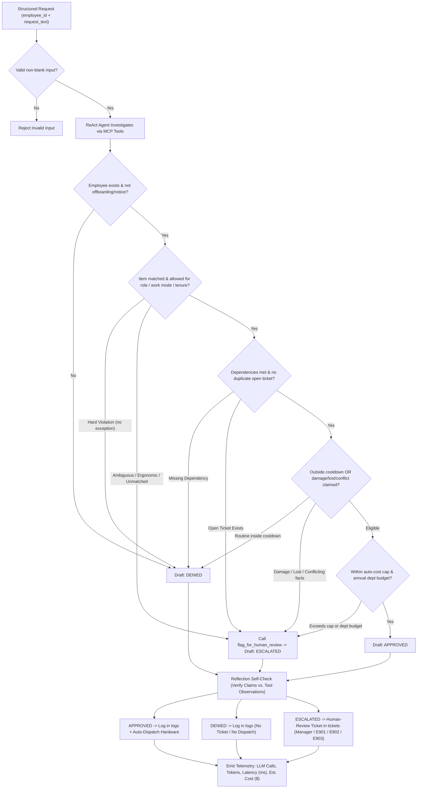

# Product Requirements & Policy Plan: Internal IT Equipment Request Handler

---

## 1. The Enterprise Problem & Our Solution

In a real enterprise, IT equipment requests are never as simple as *"does this role get a laptop every 2 years?"* Every day, IT helpdesks handle messy, high-stakes requests across a wide mix of real-world conditions:
- **Employment Type & Lifecycle:** Full-time employees vs. contractors, employees in probation, or employees in their `notice_period` / `offboarding` window where hardware spend must be frozen.
- **Work Mode:** Work-from-home (`wfh`), `hybrid`, and strictly `onsite` staff have different home-office entitlements.
- **Financial Controls:** Auto-approval cost caps for specialty gear *plus* live **annual department budgets** calculated directly from current-year dispatches.
- **Human Judgment & Exceptions:** Cracked screens, stolen laptops requiring InfoSec review, ergonomic/medical accommodations requiring HR sign-off, and requests where what the employee says (*"my laptop is 4 years old"*) contradicts company asset records (*issued 14 months ago*).

### What Makes This Solution Strong
Instead of forcing either a rigid `if/else` script (which fails on exceptions and natural language) or an unconstrained LLM (which guesses dates and hallucinates approvals), our system pairs a **deterministic policy & budget engine** (exposed via MCP) with a **ReAct + Reflection AI agent**:
- **Zero math or date guessing:** Eligibility, refresh windows, dependencies, and annual department spend are computed deterministically.
- **Smart escalation over guessing:** Ambiguous requests, policy exceptions, budget overruns, and factual conflicts are automatically routed to the exact right human reviewer (the employee's manager, IT-Ops, HR Accommodations, or InfoSec).
- **Built-in self-verification (Reflection):** Before finalizing any answer, the agent audits its own draft against the tool observations to prevent unconfirmed promises.
- **Operational Telemetry (Cost & Latency):** Every agentic request reports **LLM call count, input/output token usage, end-to-end latency, and estimated USD cost** (using configurable `.env` token pricing for `gpt-6-astra`), giving leadership real-time visibility into operational cost and ROI.

---

## 2. Request Input Contract

Every incoming equipment request uses a structured input pair:
- **`employee_id` (mandatory):** Identifies the requester (e.g., `E101`). Blank or missing IDs are rejected immediately before invoking the agent.
- **`request_text` (mandatory):** Plain-English description of what the employee needs and why (e.g., *"My laptop is 4 years old and slow, can I get a standard replacement?"* or *"My screen cracked yesterday and I need a replacement."*).

---

## 3. Hybrid Policy Model: Structured + Natural-Language Rules

Real IT policies come in two distinct forms — our system explicitly supports both:

### 3.1 Structured Policies (Deterministic Rules)
Quantitative rules enforced deterministically before any approval is granted:
1. **Role & Employment Type Entitlements** (`engineer`, `standard_employee`, `manager`, `contractor`)
2. **Work-Mode Eligibility** (`wfh`, `hybrid`, `onsite`)
3. **Maximum Active Quantity & Refresh Cadence** (months since last active issue)
4. **Per-Item Auto-Approval Cost Cap** (specialty items above cap require manager sign-off)
5. **Minimum Tenure Gate** (months since hire date)
6. **Hardware Catalog & Dependency Rules** (resolves aliases like *"Dell 27"* → `Dell 27" 4K Monitor`; enforces prerequisites such as `dock` requiring an active `laptop`)
7. **Duplicate Open-Ticket Guard** (blocks auto-approval if an `open` or `escalated` ticket already exists for that category)
8. **Dynamic Annual Department Budget** (calculated live on every request by summing current calendar-year dispatches for that department, regardless of subsequent item condition)

#### Testable Structured Policy Matrix

| Role | Employment | Work Mode | Category | Allowed | Max Qty | Refresh Window | Auto-Approval Cap |
| :--- | :--- | :--- | :--- | :--- | :--- | :--- | :--- |
| `engineer` | FTE | Any | `laptop` | Yes | 1 | 24 months | \$2,000 |
| `engineer` | FTE | WFH / Hybrid | `monitor` | Yes | 2 | 36 months | \$1,200 |
| `engineer` | FTE | WFH / Hybrid | `dock` | Yes | 1 | 36 months | \$400 |
| `standard_employee` | FTE | Any | `laptop` | Yes | 1 | 36 months | \$1,800 |
| `standard_employee` | FTE | WFH / Hybrid | `monitor` | Yes | 1 | 36 months | \$800 |
| `standard_employee` | FTE | Onsite | `monitor` | **No** | 0 | — | \$0 |
| `standard_employee` | FTE | WFH / Hybrid | `dock` | Yes | 1 | 36 months | \$400 |
| `standard_employee` | FTE | Any | `headset` | Yes | 1 | 24 months | \$200 |
| `manager` | FTE | Any | `laptop` | Yes | 1 | 24 months | \$2,500 |
| `manager` | FTE | WFH / Hybrid | `monitor` | Yes | 1 | 36 months | \$1,000 |
| `contractor` | Contractor | Any | Any | **No** | 0 | — | \$0 |

### 3.2 Natural-Language Policy Clauses (Qualitative & Exception Rules)
Rules that require reasoning over context and intent rather than a simple table lookup:
- **Lifecycle Freeze:** Employees in `notice_period` or `offboarding` status are ineligible for any new hardware dispatches and must be **denied**.
- **Hardware Damage & Diagnostics:** Cracked screens, defects, or unverified diagnostic claims (e.g., failing battery) inside a refresh window must be **escalated to IT-Ops Lead (`E901`)**.
- **Lost or Stolen Equipment:** Requires InfoSec verification regardless of refresh window; **escalate to InfoSec Lead (`E903`)**.
- **Ergonomic & Medical Accommodations:** Ergonomic chairs, vertical mice, or standing desks bypass standard catalog limits and **escalate to HR Accommodations Lead (`E902`)**.
- **Annual Department Budget Overrun:** When an otherwise eligible, reasonable request exceeds the department's remaining annual budget, **escalate to the employee's manager (`manager_id`)** rather than auto-denying.
- **Duplicate Active Tickets:** Requests overlapping an existing open/escalated ticket in the same category must not auto-approve; **escalate to IT-Ops Lead (`E901`)**.
- **Conflicting Facts:** When the employee's stated equipment age or history contradicts IT dispatch records, never guess; **escalate to IT-Ops Lead (`E901`)**.

---

## 4. Policy Evaluation & Agent Flow

---

## 5. Decision Boundaries: Approved vs. Denied vs. Escalated

| Decision | When It Applies | System Side Effects |
| :--- | :--- | :--- |
| **APPROVED** | Active employee, matched catalog item, permitted for role/work mode/tenure, dependencies met, no duplicate open ticket, outside refresh cooldown (or below max qty), within auto-approval cost cap and remaining annual department budget, and no conflicting or exception claims. | Post-reflection: records `APPROVED` in the `logs` audit table **and** automatically adds the item to `employee_resource_dispatches` (updating remaining department budget immediately). |
| **DENIED** | Unambiguous hard policy violation with no exception claimed: nonexistent employee ID (`E999`), contractor requesting company hardware, employee in `notice_period`/`offboarding`, `onsite` employee requesting a home monitor, missing required dependency (e.g., dock without laptop), or routine refresh request inside cooldown. | Post-reflection: records `DENIED` in `logs`. No ticket or hardware dispatch is created. |
| **ESCALATED** | Ambiguous, conflicting, or exception-based requests: vague/unrecognized item, physical damage or unverified diagnostic claims (`E901`), lost/stolen hardware (`E903`), ergonomic/medical need (`E902`), specialty item above auto-approval cap (`manager_id`), eligible request exceeding remaining annual department budget (`manager_id`), duplicate open ticket (`E901`), or factual mismatch with asset records (`E901`). | Calls `flag_for_human_review` with the agent-chosen `reviewer_employee_id`, creating an escalated ticket in `tickets`. Not written to `logs`. |

---

## 6. High-Level Architecture & Telemetry Overview

- **MCP Server (`stdio`):** Exposes the 4 required tools (`get_employee_info`, `get_policy_limits`, `check_request_eligibility`, `flag_for_human_review`) plus 2 focused helpers (`lookup_resource`, `finalize_request_decision`) backed by a seeded SQLite database.
- **ReAct + Reflection Agent:** Powered by Azure AI Foundry (`gpt-6-astra`), producing explicit `Thought → Action → Observation` traces followed by a Reflection audit pass before any final response or approval side effect.
- **Per-Request Cost & Latency Telemetry:** Every run measures wall-clock latency (`ms`), LLM call count, input/output token counts, and estimated USD cost computed from `.env` pricing rates. Telemetry is surfaced on every CLI and UI response and intentionally kept separate from the `logs` compliance table.
- **Operational Readiness:** Packaged in Python 3.12 with Docker containerization, 44+ automated tests (99% core coverage), and GitHub Actions CI.

---

## 7. Key Assumptions & Scope Boundaries

- **Trusted Caller Identity:** `employee_id` is assumed to be authenticated upstream (e.g., SSO or internal portal).
- **Immediate Dispatch on Approval:** Confirmed approvals are recorded as dispatched immediately so subsequent budget and cooldown checks remain consistent.
- **Out of Scope:** Physical warehouse stock counts, async manager approval portals, questions regarding SaaS/software licenses, and vendor procurement/shipping logistics.
